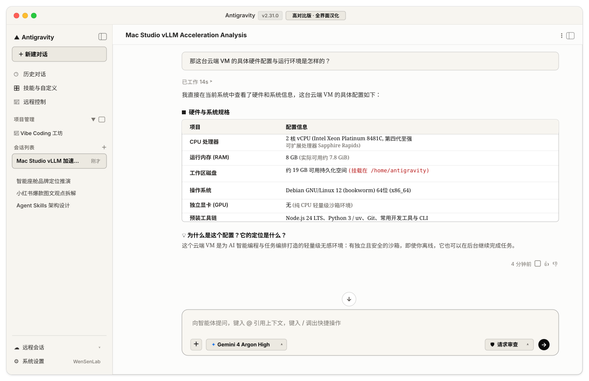

# WenSen Antigravity Theme

<p align="center">
  <b>为 macOS Google Antigravity 打造的高质感视觉排版与全界面汉化增强套件</b><br>
  <i>WenSenLab_ ©文森策 · 解决官方无中文痛点 · 原生级 UI 汉化 · 纯无侵入 CDP 注入 · 零篡改安装包 · LaunchAgent 常驻守护</i>
</p>

<p align="center">
  
  
  
  
  
</p>

---

## 📖 项目简介

**WenSen Antigravity Theme** 是一套专为 macOS Google Antigravity 客户端打造的**高质感排版美化与全界面中文汉化**增强套件。

> [!TIP]
> **直击普遍痛点：官方原生无中文界面**  
> Google Antigravity 客户端目前官方原生仅提供英文，其复杂的系统偏好、审查机制（Review Modes）、Swarm 多智能体看板与后台任务配置对于许多中文知识工作者和开发者而言存在天然门槛与视觉负担。  
> **本套件开箱即自带高质量全界面无感汉化**，无需破解或改包，一次注入即可让 Antigravity 拥有流畅自然的母语级中文交互体验与顶级的人文纸质感排版。

<p align="center">
  
</p>

基于原作者 Noel / Anarcadia 的 [Solid Ink](https://bustling-politician-00f.notion.site/chuanban-antigravity-theme-patch-db7c5846f37546be9481cd791aed0554) 视觉方案，由 **WenSenLab · 文森策** 进行工程化重构与开源封装。方案通过本机 Chrome DevTools Protocol (CDP) 进行无侵入热注入，**不修改 App 资源包、不解包 asar、不破坏系统签名**，既保留了极致典雅的人文纸气质感，又具备高稳定性的工程防护机制与纯净中文支持。

---

## ✨ 核心特性

### 🌐 1. 解决官方无中文痛点：全界面智能无感汉化（开箱即用）

为中文用户量身定制的零篡改动态本地化引擎，让全英文的 Antigravity 界面变得清晰易用：

- **深度词典覆盖**：深度中文化导航侧边栏、系统偏好设置（Settings）、审查授权模式（Request Review / Auto / Turbo）、会话历史、Swarm 蜂群看板、后台任务面板、交付物检查等 120+ 核心界面元素。
- **严苛白名单排他保护**：基于 DOM TreeWalker 监听与语义排他机制，**绝对不侵入正文 Markdown、代码块（`pre` / `code`）、终端（`.terminal`）、输入法编辑区与文件路径**，杜绝误伤代码、命令或工作文稿。
- **动态 DOM 监听**：窗口切换、弹窗加载或面板异步展开时，自动保持汉化，无需手动刷新。
- **独立自由开关**：默认随主题自动启用；若仅需视觉美化而保留英文，只需附加 `--no-i18n` 即可随时关闭。

### 🎨 2. 三套经典浅色预设

| 预设标识 | 中文别名 | 特色视觉风格 |
| :--- | :--- | :--- |
| `high-contrast` *(默认推荐)* | **高对比版** | 暖燕麦侧栏 + 微暖净白主区 + 极淡暖棕输入框 + 立体深色框线 + 纯黑操作文字 |
| `claude-desktop-purewhite` | **Claude 净白** | 净白背景 + 极淡灰白边框与侧栏 + 纯粹、克制的现代数字排版 |
| `vintage-deep` | **复古深色** | 暖纸色底 + 墨褐正文 + 暖棕侧栏（注：属于暖纸浅色系，非官方 Dark） |

### 🖋️ 3. Anthropic + 更纱四层精细排版

严格对齐作者方案的字体链与层次级回退，告别电子屏幕的生硬感：
- **UI 与导航**：`Anthropic Sans Web` → `Styrene B` → `system-ui` → `Sarasa UI SC (更纱黑体 UI SC)`
- **正文与标题**：`Anthropic Serif Web` → `Tiempos Text` → `Georgia` → `Sarasa Mono Slab SC (等距更纱黑体 Slab SC)`（行高 1.62，微调字距）
- **代码与终端**：`Anthropic Mono Web` → `Sarasa Mono Slab SC` → `ui-monospace`（原生注入 `--editor-font-family` 变量）
- **输入框与光标**：更纱 Mono Slab SC 优先，中英等宽舒适度大幅提升

### 🛡️ 4. 工程化白屏护栏与环境隔离

- **Storage 白屏护栏**：通过安全原型拦截，规范化 `theme-preset-light` 键值，彻底解决由于预设名称冲突导致的客户端初始化白屏。
- **设置路由守卫**：清理 `settingsOpen` 残留状态，杜绝设置面板关闭后背景遮罩锁死。
- **官方 Dark 隔离**：客户端切到深色模式时，补丁自动静默释放自定义样式，互不干扰。
- **Antigravity 2.x 深度适配**：支持 WebContentsView 多端点识别、新版 `[data-testid="agent-input-box"]` 选择器、Auxiliary Pane（辅助面板）与 Swarm 蜂群看板。

---

## 🚀 快速上手

### 1. 环境准备

- **操作系统**：macOS 13+
- **运行环境**：Node.js 18+（推荐 Node.js 22+，自带原生 WebSocket 支持）
- **推荐字体**：
  - **更纱黑体**：可在终端运行 `brew install --cask font-sarasa-gothic` 安装。
  - **Anthropic 官方字体**：参考原作者文档安装本地字体文件。

### 2. 启动 Antigravity 调试端口

Antigravity 需开启本地调试接口以供 CDP 连接：
```bash
# 完全退出 Antigravity 后，附加调试参数启动（仅绑定 127.0.0.1）：
/Applications/Antigravity.app/Contents/MacOS/Antigravity --remote-debugging-port=9222 &
```

### 3. 一键应用与热切换

```bash
# 1. 首次应用：默认应用高对比版 + 开启全界面中文汉化 + 安装 LaunchAgent 常驻后台守护
node scripts/cli.js apply --preset high-contrast --daemon

# 2. 如果只需要视觉排版美化，不开启中文汉化（保留英文原版界面）：
node scripts/cli.js apply --preset high-contrast --no-i18n --daemon

# 3. 随时热切换预设（无需重启客户端）
node scripts/cli.js switch claude-desktop-purewhite
node scripts/cli.js switch vintage-deep

# 4. 检查当前注入与字体命中状态
node scripts/cli.js status

# 5. 仅注入样式（轻量模式，不运行后台守护、不劫持 Storage）
node scripts/cli.js apply --preset high-contrast --lite
```

---

## ⏸️ 暂停与卸载

```bash
# 暂停主题：停止守护服务，恢复官方默认浅色与原版英文
node scripts/cli.js pause

# 恢复使用：恢复上次保存的预设与汉化配置
node scripts/cli.js resume

# 完整卸载：停止并移除 LaunchAgent 服务，清理运行时并恢复官方外观
node scripts/cli.js uninstall
```

> **提示**：运行 `uninstall` 后，完全退出并重开 Antigravity 客户端即可完全恢复初始官方外观。

---

## 📂 项目结构

```text
wensen-antigravity-theme/
├── assets/
│   ├── themes.css                                 # 核心样式表（预设配色、字体链、Solid Ink 规则）
│   ├── i18n.json                                  # 全界面汉化词典与排他白名单
│   └── com.wensenlab.antigravity-theme.plist.template  # macOS LaunchAgent 常驻模板
├── scripts/
│   ├── cli.js         # 用户命令行入口（apply, switch, status, pause, uninstall）
│   ├── daemon.js      # 后台心跳守护（窗口重连、新文档自动补注）
│   ├── cdp.js         # Loopback 本机 CDP 传输层与端点探测
│   ├── patch-core.js  # 注入代码生成器、Storage 护栏与路由守卫
│   ├── options.js     # 运行配置读取与持久化
│   └── theme.test.js  # 自动化单测回归套件
├── references/
│   └── source-baseline.md  # 方案数值基准与版本冲突处理准则
├── SKILL.md           # Agent 技能调用规范与执行指南
└── LICENSE            # MIT 开源许可证
```

---

## 🧪 单元测试

项目包含完整的隔离化单测套件（不触碰真实 App 与 LaunchAgent）：
```bash
node --test scripts/theme.test.js
```

---

## 🤝 致谢与声明

- **视觉与排版原作者**：方案源自 [chuanban Antigravity theme patch](https://bustling-politician-00f.notion.site/chuanban-antigravity-theme-patch-db7c5846f37546be9481cd791aed0554)（Noel / Anarcadia）。原作者资源的知识产权与商业授权归原作者所有。
- **开源工程封装**：由 **[WenSenLab · 文森策](https://github.com/wensenlab)** 负责工程化封装、CDP 自动化、全界面汉化、Antigravity 2.x 升级维护与开源发布。

---

## 📄 开源许可证

本项目基于 [MIT License](LICENSE) 开源。